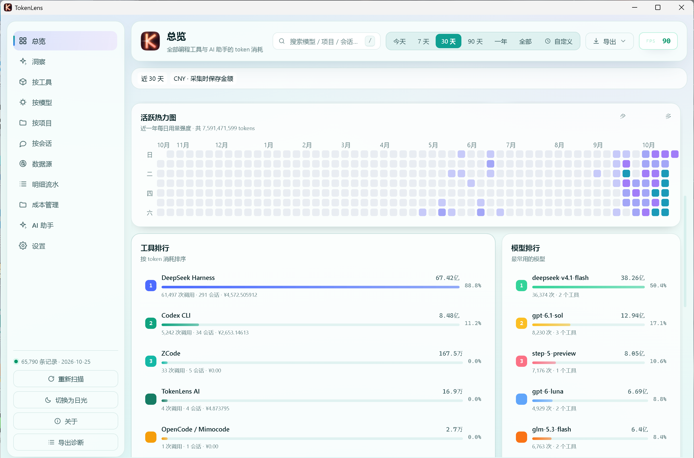
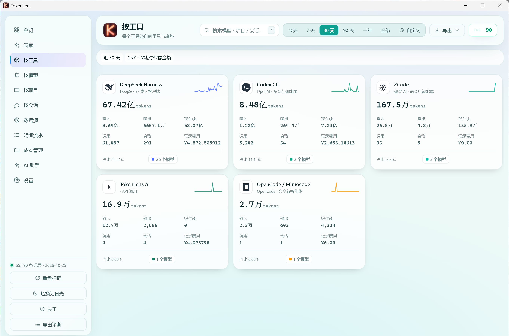
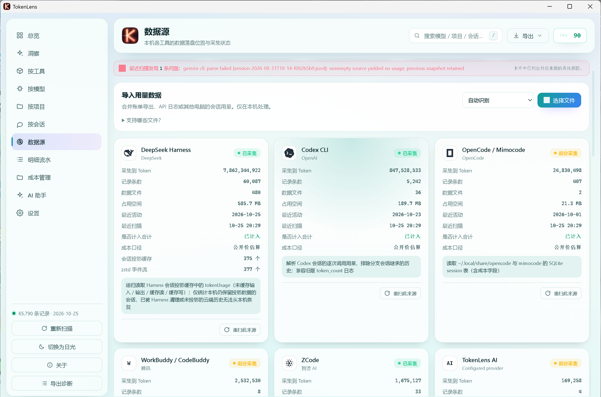

# TokenLens

**Windows 本地 AI 用量与费用工作台。** TokenLens 扫描本机 AI 编程工具写下的日志，把它们变成一本统一台账：Token、估算费用、模型、项目和会话明细——不上传任何数据。

[](https://github.com/pyyxzi/tokenlens/actions/workflows/ci.yml)
[](LICENSE)
[](https://aka.ms/windows)
[](CONTRIBUTING.md)

English | [简体中文](README.zh-CN.md)

---



<details>
<summary><b>更多截图（中文界面）</b></summary>

| 按工具分布 | 数据源 |
| :---: | :---: |
|  |  |

</details>

> English UI screenshots are available in the [English README](README.md).

## 为什么需要 TokenLens

如果你同时用多个 AI 工具——Claude Code、Codex CLI、Gemini CLI、Cursor、Copilot……每个工具都以自己的格式在自己的目录里记日志。想回答"这个月我到底烧了多少 token、花在哪个模型、哪个项目上"，就得手工逆向十几种日志格式。

TokenLens 把这件事一次性做对：

- **一本统一台账。** 25+ 个数据源归一化到同一套 schema：输入 / 输出 / 缓存读 / 缓存写 / 思维链 token，逐调用记录，事件 ID 稳定，重复扫描幂等。
- **可推理的费用。** 公开模型价目表加上你手动设置的单价生成 USD 估算；来源自带实际账单时保留实际值。只有订阅单位的来源会被如实标注，绝不冒充美元账单。
- **本地优先隐私。** 全部计算在本机完成，数据落在本地 SQLite。可选 AI 助手的 API 密钥用 Windows DPAPI 保护。没有遥测，没有云端面板。
- **为大量历史而生。** 增量扫描（未变化的文件按指纹跳过）、分页下钻、后台聚合——已在 30 万条记录、约 260 MiB 数据库上验证。
- **导入导出。** CSV / JSON / JSONL 导入（先完整校验再入库）、快照备份恢复、CSV 导出。
- **可选 AI 分析。** 内置助手可以分析用量、生成报告、优化提示词——只调用你自己配置的服务商，且只在你主动触发时请求。
- **签名自动更新。** 后台检查 GitHub Releases，一键安装经过 minisign 签名校验的更新（托盘菜单 → 检查更新…）。

## 支持的数据源

CLI 代理：Claude Code、Codex CLI、Gemini CLI、GitHub Copilot CLI、OpenCode、Aider、Goose、Pi、Kimi、ZCode、WorkBuddy、DeepSeek Harness、通用 API 日志
IDE 与编辑器：Cursor、Windsurf、Trae、Qoder、Continue、Cline 系列、JetBrains AI（经 Cline 系列）、Claude Desktop
本地运行时：Ollama、LM Studio、Cherry Studio
以及用户导入：CSV / JSON / JSONL

每个适配器读取的确切日志格式与上游参考都记录在 [backend/tokenlens/SOURCES.md](backend/tokenlens/SOURCES.md)。日志只能给出近似总量的来源会在界面上如实标注——TokenLens 绝不把估算当成精确账单展示。

## 快速开始

从 [**Releases**](../../releases) 下载最新安装包（Windows 10/11 x64，NSIS 安装器），或从源码构建：

**环境要求：** Windows 10/11 x64、WebView2、Node.js LTS、Rust（MSVC 工具链）、Python 3.14 系列（建议 3.14.8+）。

```powershell
git clone https://github.com/pyyxzi/tokenlens.git
cd REPO
.\build.ps1 -Python 'C:\path\to\python.exe' -WorkDir 'D:\tokenlens-build'
```

`WorkDir` 存放虚拟环境、依赖和构建缓存，应放在仓库**外**；安装包输出到 `<WorkDir>\target\...\bundle`。开发调试追加 `-Dev`，已有隔离环境追加 `-UseExistingPython`。

日常改后端不需要完整工具链——装个 Python 就能跑测试：

```bash
python -m unittest discover -s backend/tests -v
```

## 工作原理

```text
┌──────────────┐   spawns    ┌──────────────────┐   reads    ┌─────────────┐
│  src-tauri/  │ ──────────▶ │    backend/      │ ─────────▶ │ 工具日志    │
│  Rust 宿主:  │  sidecar    │  Python 服务:    │            │ (25+ 工具)  │
│  窗口、托盘  │ ◀────────── │  扫描 · 解析 ·   │            └─────────────┘
│  IPC 桥接    │  localhost  │  聚合 · 计价 ·   │
└──────┬───────┘  + 密钥     │  服务            │   writes   ┌─────────────┐
       │ loads     token     └──────────────────┘ ─────────▶ │ SQLite 数据 │
       ▼                                                      └─────────────┘
┌──────────────┐
│  frontend/   │  原生 JS/CSS 工作台：仪表盘、排行、
│  界面包      │  下钻明细、主题、zh-CN / en-US
└──────────────┘
```

- **`src-tauri/`** — 原生窗口、托盘、单实例，以及 Python sidecar 生命周期管理（Job 对象、崩溃恢复、按代数重连）。
- **`backend/`** — 分析引擎：各数据源适配器、增量扫描器、聚合器、价目表、AI 助手服务、导入与备份。
- **`frontend/`** — 工作台界面，无框架、无构建步骤。

## 数据与隐私

- 统计在本机完成，数据库保存在系统应用数据目录。
- 统计服务只绑定 `127.0.0.1` 的随机端口，用每次启动生成的一次性密钥鉴权；前端只通过原生桥接访问它。
- 可选 AI 助手**只**向你配置的服务商发请求，且只在你主动触发时。凭据处理见 [SECURITY.md](SECURITY.md)。
- 应用自身唯一的外发请求是对本仓库 GitHub Releases 的版本检查；更新包经 minisign 签名校验后才安装。

## 文档

- [数据源记账参考](backend/tokenlens/SOURCES.md) — 每种支持的日志格式与上游链接
- [验证记录](VALIDATION.md) — 功能、健壮性与性能测试结果
- [新增数据源](docs/adding-a-source.md) — 如何编写一个新适配器

## 参与贡献

欢迎 Issue 和 PR！新增数据源适配器是最有价值的贡献——见[适配器指南](docs/adding-a-source.md)和 [CONTRIBUTING.md](CONTRIBUTING.md)。适合上手的任务标注了 `good first issue`。

<!-- 搜索关键词 / Search keywords: token 统计 · token计数 · 用量统计 · AI 用量 · AI 费用统计 · 大模型 token 统计 · token 消耗 · 模型费用 · 本地统计 · token statistics · token counter · token usage tracker · AI cost calculator · LLM spend tracker -->

## 许可

[MIT](LICENSE) — 第三方声明见 [THIRD_PARTY_NOTICES.md](THIRD_PARTY_NOTICES.md) 和 [`licenses/`](licenses/)。
